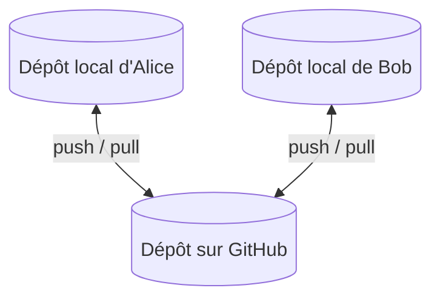
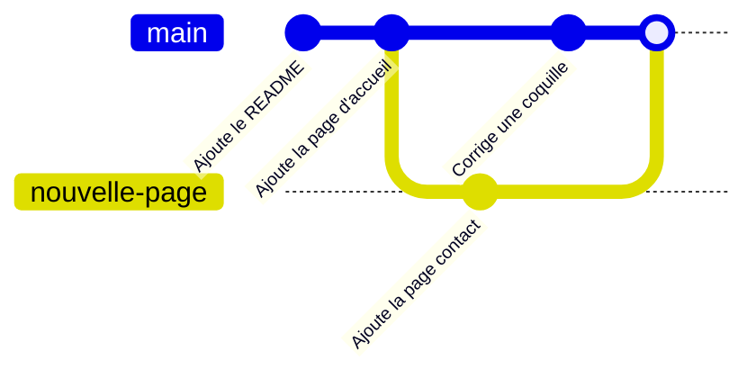

[Sommaire](Readme.md) · [Chapitre suivant →](02-Installer-et-configurer-Git.md)

# Pourquoi Git ?

## 🎯 Objectifs

À la fin de ce chapitre, vous saurez :

1. Expliquer à quoi sert un gestionnaire de versions.
2. Décrire le modèle distribué de Git.
3. Distinguer Git, l'outil, de GitHub, la plateforme.

---

## 1. Le problème : `rapport-final-v3-VRAIMENT-final.docx`

Sans outil dédié, on versionne en copiant des fichiers et des dossiers. Très vite, on ne sait plus quelle copie est la bonne, ce qui a changé entre deux versions, ni qui a modifié quoi. À plusieurs, c'est pire : on s'échange des fichiers par e-mail et on écrase le travail des autres.

Un **gestionnaire de versions** répond à ces problèmes. Il :

- enregistre l'historique complet du projet, sous forme d'**instantanés** datés, attribués à leur auteur et commentés ;
- permet de revenir à n'importe quel état passé ;
- montre précisément ce qui a changé, quand, et par qui ;
- permet de travailler à plusieurs **en parallèle** puis de réunir les travaux.

Git n'est pas réservé au code : documentation, configuration, supports de cours en Markdown… tout fichier texte s'y prête bien.

---

## 2. Un modèle distribué

Avec un outil **centralisé** (comme SVN), l'historique vit sur un serveur unique : sans réseau, on ne peut ni consulter l'historique ni enregistrer de version.

Avec Git, outil **distribué**, chaque copie de travail contient **l'historique complet** du projet. On travaille hors ligne, on enregistre localement, puis on **synchronise** avec d'autres dépôts quand on le souhaite.

Le dépôt hébergé sur GitHub n'a rien de spécial techniquement : c'est un dépôt Git comme les autres, que l'équipe a choisi comme **référence commune**.

---

## 3. Le vocabulaire

| Terme | Définition |
|---|---|
| **Dépôt** (*repository*) | le projet versionné : ses fichiers plus tout son historique, stocké dans le dossier caché `.git` |
| **Commit** | un instantané du projet, avec un auteur, une date, un message et un identifiant unique (*hash*) |
| **Branche** | une ligne de développement : un pointeur mobile vers un commit |
| **`HEAD`** | le commit (en général la branche) sur lequel on travaille actuellement |
| **Dépôt distant** (*remote*) | une autre copie du dépôt, souvent sur GitHub ; nommée `origin` par convention |
| **Fusion** (*merge*) | réunir le travail de deux branches |
| **Pull request** | sur GitHub, une demande de fusion d'une branche, avec discussion et relecture |

Un historique Git se lit comme une suite de commits, chacun pointant vers son parent :

---

## 4. Git n'est pas GitHub

| | Git | GitHub |
|---|---|---|
| Nature | logiciel libre, installé sur votre machine | service en ligne, édité par GitHub (Microsoft) |
| Rôle | versionner : commits, branches, fusions, historique | héberger des dépôts Git et collaborer autour |
| Fonctionne sans l'autre ? | oui, entièrement en local | non : il repose sur Git |
| Apports propres | — | pull requests, relecture de code, tickets (*issues*), GitHub Actions, pages web… |

GitHub n'est pas la seule plateforme : GitLab, Bitbucket, Gitea ou Forgejo jouent le même rôle. Les commandes Git de ce cours sont identiques quelle que soit la plateforme ; seuls les chapitres 05 et 06 sont propres à GitHub.

---

## 5. Vérifier ses acquis

Voir les réponses

1. *Peut-on consulter l'historique d'un dépôt Git sans connexion réseau ?* Oui : chaque copie locale contient l'historique complet.
2. *Qu'est-ce qu'un commit ?* Un instantané du projet, accompagné d'un auteur, d'une date, d'un message et d'un identifiant unique.
3. *Peut-on utiliser Git sans GitHub ?* Oui. GitHub héberge des dépôts Git et ajoute des outils de collaboration, mais Git fonctionne entièrement en local.
4. *Que désigne `origin` ?* Par convention, le dépôt distant de référence, celui dont on a cloné le projet ou qu'on a ajouté en premier.

---

[Sommaire](Readme.md) · [Chapitre suivant →](02-Installer-et-configurer-Git.md)
