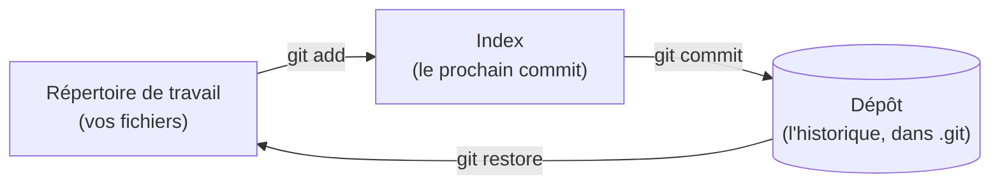

[← Chapitre précédent](02-Installer-et-configurer-Git.md) · [Sommaire](Readme.md) · [Chapitre suivant →](04-Branches-et-fusions.md)

# Premiers commits

## 🎯 Objectifs

À la fin de ce chapitre, vous saurez :

1. Expliquer les trois zones de Git : répertoire de travail, index, dépôt.
2. Créer un dépôt et enregistrer des commits.
3. Consulter l'historique et les différences.
4. Ignorer des fichiers et annuler une modification.

---

## 1. Les trois zones

Git ne prend pas une photo de vos fichiers à chaque sauvegarde. Vous **choisissez** ce qui entre dans le prochain commit, en passant par une zone intermédiaire, l'**index** (*staging area*) :



L'index permet de découper son travail en commits cohérents : on peut modifier cinq fichiers et n'en committer que deux.

---

## 2. Créer un dépôt

```bash
mkdir mon-projet
cd mon-projet
git init
```

Git crée un dossier caché `.git` : c'est **le dépôt**, qui contiendra tout l'historique. Supprimer `.git`, c'est supprimer l'historique ; le reste du dossier n'est que la copie de travail.

---

## 3. Le cycle de base

Créez un fichier `README.md` contenant une ligne de texte, puis :

```bash
git status
```

Git signale un fichier **non suivi** (*untracked*) : il existe, mais Git ne le versionne pas encore.

```bash
git add README.md
git status
```

Le fichier est maintenant **indexé** : il fera partie du prochain commit.

```bash
git commit -m "Ajoute le README"
```

Le commit est enregistré. Modifiez maintenant `README.md`, puis :

```bash
git status       # le fichier apparaît comme modifié
git diff         # ce qui a changé et n'est pas encore indexé
git add README.md
git diff --staged    # ce qui est indexé et partira dans le commit
git commit -m "Décrit le projet dans le README"
```

> `git add .` indexe toutes les modifications du dossier courant. Pratique, mais vérifiez toujours avec `git status` avant de committer : c'est ainsi qu'on évite de versionner un fichier de mots de passe par accident.

### Écrire un bon message de commit

- Une première ligne **courte** (une cinquantaine de caractères) qui dit **ce que fait** le commit : « Ajoute la page contact », « Corrige le calcul de la TVA ».
- Si besoin, une ligne vide puis un paragraphe qui explique **pourquoi**.
- Un commit = une modification cohérente. « Divers » ou « wip » ne disent rien à celui qui lira l'historique dans six mois, c'est-à-dire souvent vous.

---

## 4. Consulter l'historique

```bash
git log                      # historique détaillé
git log --oneline            # un commit par ligne
git log --oneline --graph --all   # avec les branches, dessinées
git show                     # le dernier commit et son contenu
git show <hash>              # un commit précis (les 7 premiers caractères suffisent)
```

Chaque commit est identifié par un **hash** : une empreinte calculée à partir de son contenu, de ses métadonnées et de son parent. Changer quoi que ce soit dans un commit change son hash, et celui de tous les commits suivants : on ne peut pas modifier l'historique discrètement.

---

## 5. Ignorer des fichiers

Certains fichiers n'ont rien à faire dans l'historique : dépendances téléchargées, fichiers compilés, journaux, fichiers de l'éditeur, et surtout **secrets** (`.env`, clés…). On les liste dans un fichier `.gitignore`, à la racine du dépôt :

```text
# Dépendances et fichiers générés
node_modules/
dist/
*.log

# Secrets : à ne jamais versionner
.env

# Fichiers système et d'éditeur
.DS_Store
.vscode/
```

Le `.gitignore` lui-même se versionne : toute l'équipe partage les mêmes règles. Des modèles par langage sont disponibles sur [github.com/github/gitignore](https://github.com/github/gitignore).

> Un fichier **déjà versionné** n'est pas concerné par le `.gitignore`. Pour arrêter de le suivre sans le supprimer du disque : `git rm --cached <fichier>`, puis commit.

---

## 6. Annuler

| Situation | Commande |
|---|---|
| Annuler les modifications non indexées d'un fichier | `git restore <fichier>` |
| Retirer un fichier de l'index (sans perdre les modifications) | `git restore --staged <fichier>` |
| Corriger le message ou compléter le **dernier** commit, pas encore partagé | `git commit --amend` |
| Annuler un commit **déjà partagé** | `git revert <hash>` |

> ⚠️ `git restore <fichier>` écrase vos modifications non committées : elles sont perdues. `git revert`, lui, ne détruit rien : il crée un **nouveau commit** qui défait le précédent, ce qui préserve l'historique des autres.

---

## 7. Exercice

1. Créez un dépôt `exo-git` et un fichier `notes.md` contenant « Première ligne ». Committez-le.
2. Ajoutez une deuxième ligne, observez `git diff`, puis committez.
3. Créez un fichier `secret.env` et faites en sorte que Git l'ignore. Committez le `.gitignore`.
4. Ajoutez une troisième ligne à `notes.md`, puis annulez cette modification sans committer.
5. Affichez l'historique sur une ligne par commit : combien de commits voyez-vous ?

<details>
<summary>Voir la correction</summary>

```bash
# 1
mkdir exo-git && cd exo-git
git init
echo "Première ligne" > notes.md
git add notes.md
git commit -m "Ajoute les notes"

# 2
echo "Deuxième ligne" >> notes.md
git diff
git commit -am "Complète les notes"

# 3
echo "MOT_DE_PASSE=123" > secret.env
echo "secret.env" > .gitignore
git status          # secret.env n'apparaît plus, .gitignore oui
git add .gitignore
git commit -m "Ignore le fichier de secrets"

# 4
echo "Troisième ligne" >> notes.md
git restore notes.md

# 5
git log --oneline   # trois commits
```

`git commit -am` indexe puis committe en une fois toutes les modifications des fichiers **déjà suivis** ; il n'ajoute jamais un fichier nouveau.

</details>

---

[← Chapitre précédent](02-Installer-et-configurer-Git.md) · [Sommaire](Readme.md) · [Chapitre suivant →](04-Branches-et-fusions.md)
