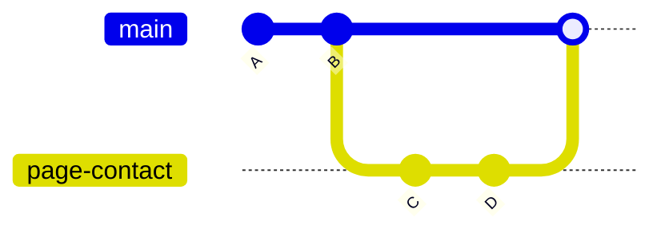

[← Chapitre précédent](03-Premiers-commits.md) · [Sommaire](Readme.md) · [Chapitre suivant →](05-Travailler-avec-GitHub.md)

# Branches et fusions

## 🎯 Objectifs

À la fin de ce chapitre, vous saurez :

1. Créer une branche et passer d'une branche à l'autre.
2. Fusionner une branche dans une autre.
3. Résoudre un conflit de fusion.

---

## 1. Pourquoi des branches ?

Une **branche** est une ligne de développement indépendante. On en crée une pour chaque fonctionnalité ou correction : on peut y expérimenter sans risque, pendant que `main` reste stable et livrable. Quand le travail est prêt, on le **fusionne** dans `main` ; s'il est abandonné, on supprime la branche.

Techniquement, une branche n'est qu'un **pointeur** vers un commit, qui avance à chaque nouveau commit. En créer une est instantané et ne copie aucun fichier.



---

## 2. Créer et changer de branche

```bash
git branch                   # liste les branches ; * marque la branche courante
git switch -c page-contact   # crée la branche et bascule dessus
git switch main              # revient sur main
git branch -d page-contact   # supprime une branche déjà fusionnée
```

Changer de branche **met à jour les fichiers** du répertoire de travail pour refléter l'état de la branche. Committez (ou mettez de côté) vos modifications avant de changer : Git refuse de basculer si cela devait écraser un travail non enregistré.

> Vous croiserez souvent `git checkout` dans les tutoriels : c'est l'ancienne commande, qui fait à la fois ce que font `git switch` (changer de branche) et `git restore` (restaurer des fichiers). Elle fonctionne toujours, mais les deux commandes séparées sont plus claires.

---

## 3. Fusionner

On se place sur la branche qui **reçoit**, puis on fusionne la branche qui **apporte** :

```bash
git switch main
git merge page-contact
```

Deux cas se présentent :

| Cas | Ce que fait Git |
|---|---|
| `main` n'a pas bougé depuis la création de la branche | **avance rapide** (*fast-forward*) : `main` est simplement déplacée sur le dernier commit de la branche |
| `main` a reçu d'autres commits entre-temps | **commit de fusion** : un nouveau commit à deux parents réunit les deux historiques |

Dans le second cas, Git ouvre votre éditeur pour le message du commit de fusion ; le message proposé convient, il suffit d'enregistrer et de fermer.

---

## 4. Les conflits

Si les deux branches ont modifié **les mêmes lignes** d'un même fichier, Git ne peut pas décider seul : la fusion s'arrête sur un **conflit**.

```text
CONFLICT (content): Merge conflict in index.html
Automatic merge failed; fix conflicts and then commit the result.
```

Le fichier contient alors les deux versions, entre des marqueurs :

```text
<<<<<<< HEAD
<h1>Bienvenue sur mon site</h1>
=======
<h1>Bienvenue !</h1>
>>>>>>> titre-court
```

- entre `<<<<<<< HEAD` et `=======` : la version de la branche courante ;
- entre `=======` et `>>>>>>>` : la version de la branche fusionnée.

Pour résoudre :

1. Éditez le fichier : gardez l'une des versions, ou une combinaison des deux, et **supprimez les trois marqueurs**.
2. Indexez le fichier résolu : `git add index.html`.
3. Terminez la fusion : `git commit` (le message est prérempli).

```bash
git status          # liste les fichiers en conflit
git merge --abort   # abandonne la fusion et revient à l'état d'avant
```

> Les éditeurs comme Visual Studio Code détectent les marqueurs et proposent « Accepter la modification actuelle / entrante / les deux ». C'est plus confortable, mais le principe reste le même.

Un conflit n'est **pas une erreur** : c'est Git qui vous demande de trancher. On en limite le nombre avec des branches courtes et fusionnées souvent.

---

## 5. Exercice

Dans le dépôt `exo-git` du chapitre 03 :

1. Créez une branche `ajout-titre`, ajoutez la ligne `# Mes notes` **en haut** de `notes.md` et committez.
2. Revenez sur `main` et fusionnez `ajout-titre`. Quel type de fusion Git a-t-il réalisé ?
3. Créez une branche `titre-anglais` et remplacez la première ligne par `# My notes`. Committez.
4. Revenez sur `main`, remplacez la première ligne par `# Notes de cours`. Committez.
5. Fusionnez `titre-anglais` dans `main`, résolvez le conflit en gardant `# Notes de cours`, terminez la fusion.
6. Affichez l'historique en graphe, puis supprimez les deux branches.

<details>
<summary>Voir la correction</summary>

```bash
# 1
git switch -c ajout-titre
# éditer notes.md : ajouter « # Mes notes » en première ligne
git commit -am "Ajoute un titre aux notes"

# 2
git switch main
git merge ajout-titre
```

Git annonce `Fast-forward` : `main` n'avait pas bougé, elle a simplement avancé jusqu'au commit de la branche.

```bash
# 3
git switch -c titre-anglais
# éditer notes.md : première ligne « # My notes »
git commit -am "Traduit le titre"

# 4
git switch main
# éditer notes.md : première ligne « # Notes de cours »
git commit -am "Renomme le titre"

# 5
git merge titre-anglais      # CONFLICT (content): Merge conflict in notes.md
# éditer notes.md : garder « # Notes de cours », supprimer les marqueurs
git add notes.md
git commit                   # valider le message proposé

# 6
git log --oneline --graph --all
git branch -d ajout-titre titre-anglais
```

Le graphe montre les deux lignes de développement qui se rejoignent sur le commit de fusion. `git branch -d` accepte de supprimer les deux branches, puisqu'elles sont fusionnées : leurs commits restent dans l'historique de `main`.

</details>

---

[← Chapitre précédent](03-Premiers-commits.md) · [Sommaire](Readme.md) · [Chapitre suivant →](05-Travailler-avec-GitHub.md)
