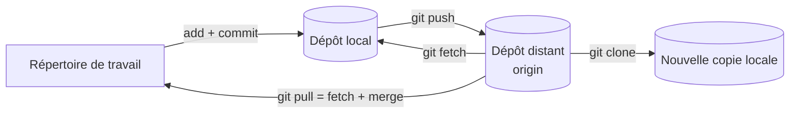

[← Chapitre précédent](04-Branches-et-fusions.md) · [Sommaire](Readme.md) · [Chapitre suivant →](06-Collaborer-avec-les-pull-requests.md)

# Travailler avec GitHub

## 🎯 Objectifs

À la fin de ce chapitre, vous saurez :

1. Créer un compte GitHub et vous authentifier depuis votre machine.
2. Publier un dépôt local sur GitHub.
3. Synchroniser avec `push`, `fetch` et `pull`, et cloner un dépôt.

---

## 1. Créer son compte

Créez un compte gratuit sur [github.com](https://github.com/), puis activez l'**authentification à deux facteurs** (*Settings → Password and authentication*) : GitHub l'exige de tous les comptes qui contribuent du code.

Pour ne pas publier votre adresse e-mail dans les commits, GitHub vous attribue une adresse `…@users.noreply.github.com`, visible dans *Settings → Emails*. Vous pouvez l'utiliser comme `user.email` (chapitre 02).

---

## 2. S'authentifier depuis Git

GitHub **n'accepte pas votre mot de passe** pour les opérations Git (`push`, `pull`…). Il existe deux voies d'accès, au choix.

| Accès | URL du dépôt | Authentification |
|---|---|---|
| **HTTPS** (recommandé pour débuter) | `https://github.com/<compte>/<dépôt>.git` | via la GitHub CLI ou Git Credential Manager, qui gèrent un jeton à votre place |
| **SSH** | `git@github.com:<compte>/<dépôt>.git` | une paire de clés SSH, la clé publique étant déclarée sur GitHub |

### Option A — HTTPS avec la GitHub CLI (recommandé)

La **GitHub CLI** (`gh`) pilote GitHub depuis le terminal et configure l'authentification de Git en une commande. Installez-la :

```powershell
winget install --id GitHub.cli     # Windows
```

```bash
brew install gh                    # macOS
```

Sous Linux, suivez les instructions officielles pour ajouter le dépôt de paquets de GitHub : [github.com/cli/cli#installation](https://github.com/cli/cli#installation).

Puis connectez-vous :

```bash
gh auth login
```

Répondez aux questions : **GitHub.com**, protocole **HTTPS**, **oui** pour authentifier Git avec vos identifiants GitHub, puis connexion **par le navigateur**. Vérifiez :

```bash
gh auth status
```

> Sous Windows, Git for Windows inclut aussi **Git Credential Manager** : au premier `git push`, une fenêtre de connexion GitHub s'ouvre et l'accès est mémorisé. Les deux approches fonctionnent ; `gh` apporte en plus les commandes du chapitre 06.

### Option B — SSH

```bash
ssh-keygen -t ed25519 -C "prenom.nom@example.com"   # accepter l'emplacement proposé, choisir une phrase de passe
```

Déclarez ensuite la clé **publique** (`~/.ssh/id_ed25519.pub`, jamais la clé privée) sur GitHub, dans *Settings → SSH and GPG keys → New SSH key*, ou avec `gh ssh-key add ~/.ssh/id_ed25519.pub`. Testez :

```bash
ssh -T git@github.com
# Hi <compte>! You've successfully authenticated, but GitHub does not provide shell access.
```

---

## 3. Publier un dépôt local

### Avec l'interface web

1. Sur GitHub : **New repository**, choisissez un nom, la visibilité (*Public* ou *Private*), et **ne cochez rien** d'autre (ni README, ni `.gitignore`, ni licence) : votre dépôt local a déjà son historique.
2. Dans votre dépôt local, déclarez le dépôt distant et poussez :

```bash
git remote add origin https://github.com/<compte>/<dépôt>.git
git push -u origin main
```

`-u` relie votre branche `main` locale à `origin/main` : ensuite, un simple `git push` ou `git pull` suffit.

### Avec la GitHub CLI

Depuis le dossier du dépôt, une seule commande crée le dépôt sur GitHub, ajoute `origin` et pousse :

```bash
gh repo create <dépôt> --private --source=. --push
```

---

## 4. Synchroniser



| Commande | Effet |
|---|---|
| `git push` | envoie vos commits locaux vers `origin` |
| `git fetch` | récupère les nouveautés de `origin` **sans toucher** à vos fichiers ni à vos branches |
| `git pull` | `fetch` puis fusion dans la branche courante |
| `git clone <url>` | crée une copie locale complète d'un dépôt distant, avec `origin` déjà configuré |
| `git remote -v` | affiche les dépôts distants configurés |

Si `git push` est refusé (`rejected … fetch first`), c'est que le dépôt distant contient des commits que vous n'avez pas encore. Faites `git pull`, résolvez un éventuel conflit (chapitre 04), puis poussez à nouveau.

> Prenez l'habitude de faire `git pull` **avant** de commencer à travailler : moins vous divergez du dépôt distant, moins vous aurez de conflits.

---

## 5. Exercice

1. Publiez le dépôt `exo-git` des chapitres précédents sur GitHub, en dépôt **privé**.
2. Sur GitHub, ouvrez `notes.md`, modifiez-le avec l'icône crayon et validez (*Commit changes*).
3. En local, vérifiez avec `git status` que votre dépôt ne « voit » pas encore cette modification, puis récupérez-la.
4. Dans un autre dossier, clonez le dépôt et vérifiez que l'historique complet est présent.

<details>
<summary>Voir la correction</summary>

```bash
# 1 (avec la GitHub CLI ; sinon interface web + git remote add + git push -u)
cd exo-git
gh repo create exo-git --private --source=. --push

# 3
git status     # « Your branch is up to date with 'origin/main' » : Git ne sait pas encore
git pull       # récupère et intègre le commit fait sur GitHub
git log --oneline

# 4
cd ..
git clone https://github.com/<compte>/exo-git.git exo-git-clone
cd exo-git-clone
git log --oneline   # même historique que le dépôt d'origine
```

À l'étape 3, `git status` compare votre branche à la **dernière image connue** de `origin/main`, qui n'est mise à jour que par `fetch` ou `pull`. C'est pour cela qu'il annonce être à jour alors que GitHub contient un commit de plus.

</details>

---

[← Chapitre précédent](04-Branches-et-fusions.md) · [Sommaire](Readme.md) · [Chapitre suivant →](06-Collaborer-avec-les-pull-requests.md)
