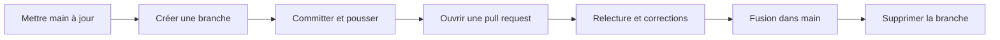
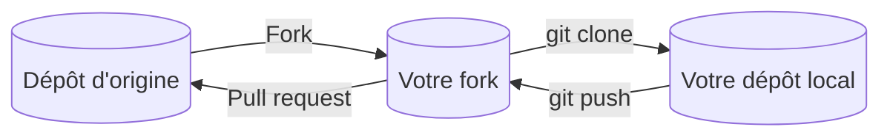

[← Chapitre précédent](05-Travailler-avec-GitHub.md) · [Sommaire](Readme.md) · [Chapitre suivant →](A-Aide-memoire.md)

# Collaborer avec les pull requests

## 🎯 Objectifs

À la fin de ce chapitre, vous saurez :

1. Suivre le GitHub Flow : une branche par modification, fusionnée par pull request.
2. Ouvrir, relire et fusionner une pull request.
3. Contribuer à un projet sur lequel vous n'avez pas les droits d'écriture, grâce à un fork.

---

## 1. Le GitHub Flow

Dans une équipe, on ne pousse pas directement sur `main`. Chaque modification suit le même cycle, appelé **GitHub Flow** :



Une **pull request** (PR) est une demande de fusion d'une branche dans une autre, accompagnée d'un espace de discussion. Elle montre les différences, permet de commenter chaque ligne, et c'est là que s'exécutent les vérifications automatiques (tests, analyse…) quand le projet en a.

---

## 2. Proposer une modification

```bash
git switch main
git pull                          # partir d'une main à jour
git switch -c corrige-coquilles   # une branche par modification, au nom explicite
# … modifications …
git commit -am "Corrige les coquilles du README"
git push -u origin corrige-coquilles
```

Ouvrez ensuite la pull request :

- **dans le navigateur** : GitHub affiche un bandeau *Compare & pull request* sur la page du dépôt juste après le push ;
- **en ligne de commande** :

```bash
gh pr create --fill    # titre et description repris des commits
```

Une bonne PR est **petite** et **ciblée**, et sa description dit **quoi** et **pourquoi**. Si elle règle un ticket, écrivez `Closes #12` dans la description : le ticket 12 sera fermé automatiquement à la fusion.

---

## 3. Relire

Sur la PR, l'onglet *Files changed* montre les différences. Le relecteur peut commenter une ligne, suggérer une modification, puis conclure sa revue par :

| Conclusion | Sens |
|---|---|
| **Comment** | remarques sans avis tranché |
| **Approve** | la PR peut être fusionnée |
| **Request changes** | des corrections sont nécessaires avant fusion |

Pour corriger, l'auteur committe et pousse **sur la même branche** : la PR se met à jour toute seule.

```bash
gh pr list              # PR ouvertes du dépôt
gh pr checkout 7        # récupère localement la branche de la PR n° 7, pour la tester
```

> Relire, c'est vérifier que le code est correct, compréhensible et cohérent avec le projet ; pas juger son auteur. Des commentaires précis et bienveillants font des équipes qui relisent vraiment.

---

## 4. Fusionner

Le bouton de fusion de GitHub propose trois méthodes :

| Méthode | Résultat dans `main` | Quand l'utiliser |
|---|---|---|
| **Create a merge commit** | tous les commits de la branche, plus un commit de fusion | conserver l'historique détaillé |
| **Squash and merge** | un seul commit qui regroupe toute la PR | historique de `main` lisible, une PR = un commit |
| **Rebase and merge** | les commits de la branche, rejoués à la suite de `main`, sans commit de fusion | historique linéaire et commits soignés |

Après la fusion, supprimez la branche (GitHub le propose), puis mettez votre dépôt local à jour :

```bash
git switch main
git pull
git branch -d corrige-coquilles
```

> Après un *Squash and merge*, Git ne reconnaît pas la branche locale comme fusionnée et `git branch -d` refuse de la supprimer. Si la PR est bien fusionnée sur GitHub, `git branch -D` force la suppression.

Les administrateurs d'un dépôt peuvent **protéger** `main` (*Settings → Rules*) : interdire le push direct, exiger une PR, une ou plusieurs approbations, des vérifications réussies.

---

## 5. Contribuer sans droits d'écriture : le fork

Sur un projet open source, vous ne pouvez pas pousser de branche dans le dépôt d'origine. On passe alors par un **fork** : une copie du dépôt sous votre compte, dans laquelle vous poussez, puis depuis laquelle vous ouvrez la PR vers le dépôt d'origine.



```bash
gh repo fork <compte>/<dépôt> --clone   # fork + clone ; « upstream » pointe vers l'origine
```

Avant chaque nouvelle contribution, synchronisez votre fork avec l'origine : bouton *Sync fork* sur la page de votre fork, ou `gh repo sync <votre-compte>/<dépôt>`, puis `git pull` en local.

| | Branche dans le dépôt | Fork |
|---|---|---|
| Droits nécessaires | écriture sur le dépôt | aucun (dépôt public) |
| Cas typique | équipe d'un même projet | contribution open source, contributeur externe |

---

## 6. Exercice

Seul, sur votre dépôt `exo-git` (ou à deux, en invitant votre binôme via *Settings → Collaborators*) :

1. Créez un ticket « Ajouter une section Sources » (onglet *Issues*), notez son numéro.
2. Créez une branche, ajoutez une section `## Sources` à `notes.md`, poussez la branche.
3. Ouvrez une pull request dont la description ferme le ticket.
4. Laissez un commentaire sur une ligne de la PR, puis poussez un second commit qui en tient compte.
5. Fusionnez par **Squash and merge**, supprimez la branche et mettez votre dépôt local à jour.
6. Vérifiez que le ticket est fermé et que `main` ne contient qu'**un** commit pour toute la PR.

<details>
<summary>Voir la correction</summary>

```bash
# 2
git switch main && git pull
git switch -c ajout-sources
# éditer notes.md : ajouter « ## Sources »
git commit -am "Ajoute une section Sources"
git push -u origin ajout-sources

# 3 (numéro de ticket : 1 dans cet exemple)
gh pr create --title "Ajoute une section Sources" --body "Closes #1"

# 4 : commenter dans l'onglet Files changed, puis
git commit -am "Précise la section Sources"
git push

# 5 : bouton Squash and merge, puis Delete branch, puis
git switch main
git pull
git branch -D ajout-sources    # -D : la branche a été fusionnée par squash
git log --oneline
```

Le ticket est fermé et mentionne la PR qui l'a résolu. `git log --oneline` montre un unique commit pour la PR, intitulé par défaut comme elle, suivi de son numéro (par exemple `Ajoute une section Sources (#2)`) : tickets et pull requests partagent la même numérotation.

</details>

---

## Pour aller plus loin

- **`git rebase`** : réécrire une branche au-dessus d'une autre, pour un historique linéaire ; à réserver aux branches que vous êtes seul à utiliser.
- **`git stash`** : mettre de côté des modifications non committées le temps de changer de branche.
- **GitHub Actions** : lancer tests et déploiements automatiquement à chaque push ou pull request.
- **Pro Git**, le livre de référence, gratuit et traduit en français : [git-scm.com/book/fr](https://git-scm.com/book/fr/v2).

---

[← Chapitre précédent](05-Travailler-avec-GitHub.md) · [Sommaire](Readme.md) · [Chapitre suivant →](A-Aide-memoire.md)
